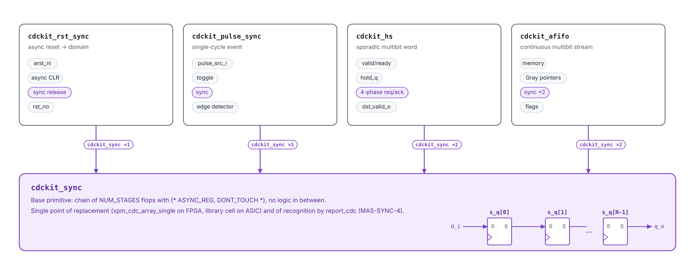
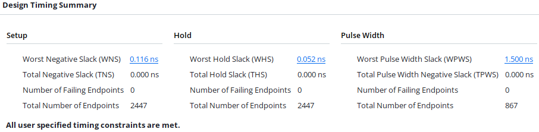
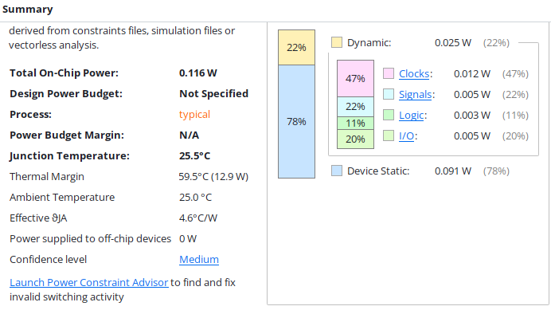

# CDC-Kit — Clock Domain Crossing Toolkit

Synthesizable SystemVerilog library for moving data safely between unrelated clock domains, targeting AMD Artix-7 (`xc7a100tcsg324-1`). It is the MAC ↔ core interface block of NetSwitch-4, a mini Ethernet switch portfolio project.

**Status:** RTL complete and smoke-tested. UVM verification is next. Results below are preliminary.



## Progress

```text
── Phase 1 · Spec & Planning ──
✅[AI] Generate the spec draft for CDC-Kit: features, interfaces, parameters, clocks, resets, performance targets
✅Review and freeze the spec, assigning requirement IDs (FUNC, PARAM, CLK, RST, PERF, INTG, MAS), i.e [FUNC-3]
✅Write the micro-architecture (MAS): block diagram, FSMs, timing diagrams, latency/throughput budget, Artix-7 resource estimate
✅[AI] Ask AI to check the spec and MAS for ambiguities, untestable or missing requirements

── Phase 2 · RTL ──
✅Writing the RTL
✅[AI] Tag each requirement in the code using the format i.e // [MAS-RST-1]
✅ [AI] Write the XDC constraints (clocks, clock groups, set_max_delay -datapath_only for CDC, I/O delays)
✅ Compile and elaborate on Vivado (xvlog/xelab) for syntax errors
✅ [AI] RTL syntax and recommendations review from AI (synthesizability, latches, CDC/RDC, resets, critical paths)
✅ Lint with Vivado and fix errors
✅ [AI] Help describe the waive for every warning with a justification and document all the Lint descitions and results
✅ [AI] Ask AI to check all requirement IDs are implemented and tagged in RTL/SVA, and flag missing ones
✅ Write the SVA (protocol, invariants, CDC)
✅[AI] Generate a directed smoke test to validate basic functionality before UVM
✅Check if the smoke test pass
✅ Document all the smoke test results at rtl README
✅ Run an out-of-context synthesis and check report_cdc, report_methodology and inference warnings ↺
✅ Document all the important reports at the repo README and the rtl README, including images of preliminary Power, Timing and Utilization

── Phase 3 · UVM Verification ──
⏩ Generate the testplan FROM THE SPEC in a xml file: scenarios, checkers, SVA list and coverpoints, each mapped to a requirement ID
[AI] Ask AI to check testplan and do upgrades and corrections (corner cases, weak checkers, coverage holes)
UVM environment generation (agents, independent reference model, scoreboard, coverage, base test)
[AI] UVM syntax and recommendations review from AI (phasing, objections, races, factory/config_db, model independence)
Write the tests, sequences and plusargs from the testplan
[AI] Ask AI to check and comment all the tests, plusargs and verification requirements on the code, and check if there's missing requirements
Simulate on Vivado (xsim) the base test for syntax errors
Run the random-seed regression and fix RTL/TB bugs found ↺
Run the bug-injection campaign (BUG parameter): every injected bug must be caught by a checker
Merge and analyze code + functional coverage (xcrg) ↺
[AI] Ask AI to review coverage holes and propose closure (new constraints, tests or justified exclusions)
(Optional) Formal proof of key properties with SymbiYosys

── Phase 4 · Implementation ──
Synthesis and implementation on Vivado for xc7a100tcsg324-1 at the target frequency
Timing closure: WNS/TNS/WHS ≥ 0, clean report_cdc, no critical methodology warnings ↺
[AI] Ask AI to review synthesis/implementation reports (critical paths, inferred BRAM/SRL/DSP, optimizations)
Generate the bitstream
(If board available) Validate on hardware with a demo wrapper + ILA

── Phase 5 · Signoff & Documentation ──
Report PPA: Fmax, LUT/FF/BRAM/DSP, report_power, latency/throughput, coverage %, bugs caught
Fill the traceability matrix (requirement → RTL → SVA → test → coverpoint → status)
[AI] Write the README, Overview and Key Contributions & Architecture
Write the interview notes: design decisions, trade-offs, bug-injection results
Tag the release in git (v1.0) and archive the reports
```

## Primitives

| Module | Carries | Technique |
|---|---|---|
| `cdckit_sync` | Level or independent bits | 2–4 stage `ASYNC_REG` synchronizer, single replacement point for all crossings |
| `cdckit_rst_sync` | Reset | Asynchronous assertion, synchronous release |
| `cdckit_pulse_sync` | Single-cycle events | Toggle crossing, with an arm window that blocks false pulses after a destination reset |
| `cdckit_hs` | Sporadic multibit words | 4-phase handshake, holding register, recovery from source-only resets |
| `cdckit_afifo` | Continuous streams | Gray pointers, first-word fall-through, conservative flags, LUTRAM storage |

## Key features

- 1 word/cycle sustained FIFO throughput per port, by design.
- Parameterized width, depth, thresholds and synchronizer stages, with elaboration-time checks.
- Requirement IDs frozen in a spec and tagged in the RTL.
- Crossing table with the expected `report_cdc` rule for each crossing.
- Self-checking LFSR implementation harness that exercises all five primitives.

## Results

> **Preliminary.** All figures were obtained before functional (UVM) verification and may change if verification requires RTL fixes. Read [Methodology and limitations](#methodology-and-limitations) before quoting any number.

| Check | Result | Tool |
|---|---|---|
| RTL lint | 7 findings, all justified and waived; 0 RTL changes | Vivado 2026.1 RTL Linter |
| Smoke test | 6 of 6 directed tests pass, 0 errors | Vivado 2026.1 xsim |
| CDC structure, per module and in the harness | 0 Critical; every Warning is an expected crossing type (§15.2 of the spec) | Vivado 2026.1 `report_cdc` |
| Timing at reference clocks, per module and in the harness | All met: WNS ≥ 0, WHS ≥ 0 | Vivado 2026.1 |
| Inference | 0 latches, 0 SRLs, 0 Block RAM; FIFO storage in LUTRAM | Vivado 2026.1 |
| Functional coverage | Pending (Phase 3) | — |

### FPGA results per module

Each primitive implemented on its own, out of context, on Artix-7 `xc7a100tcsg324-1` (speed grade -1), reference configuration.

| Module | Configuration | LUT (logic) | LUTRAM | FF | Slices | Reference clocks | Worst setup slack | Fmax (estimate) | Dynamic power |
|---|---|---|---|---|---|---|---|---|---|
| `cdckit_afifo` | 72 b × 32, N = 2 | 49 | 48 | 66 | 37 | 156.25 → 250 MHz | +0.220 ns (`rclk`) | ≈ 278 MHz `rclk`, ≈ 285 MHz `wclk` | 5 mW |
| `cdckit_hs` | 64 b, N = 2 | 7 | 0 | 137 | 27 | 156.25 → 100 MHz | +4.098 ns | ≥ 400 MHz | 2 mW |
| `cdckit_pulse_sync` | N = 2 | 4 | 0 | 9 | 2 | 100 → 156.25 MHz | +4.819 ns | ≥ 400 MHz | < 1 mW |
| `cdckit_rst_sync` | N = 2 | 1 | 0 | 2 | 1 | 250 MHz | +3.237 ns | ≥ 400 MHz | < 1 mW |
| `cdckit_sync` | 1 b, N = 2 | 0 | 0 | 2 | — | — | — | — | — |

| Module | `report_cdc` findings |
|---|---|
| `cdckit_afifo` | CDC-6 ×2 (Gray pointer buses), 0 Critical |
| `cdckit_hs` | CDC-3 ×2 (`req`, `ack`), CDC-15 ×64 (enable-qualified data bus), 0 Critical |
| `cdckit_pulse_sync` | CDC-3 ×1 (toggle level), 0 Critical |
| `cdckit_rst_sync` | CDC-9 ×1 (reset synchronizer), 0 Critical |

The FIFO matches the planning estimate exactly: 66 FF and 12 × `RAM32M`.

### Worst timing paths per module

Post-route, reference clocks, same out-of-context runs as above. Setup at the slow corner, hold at the fast corner.

| Module | Clock | Setup slack | Worst setup path (data delay, logic levels) | Hold slack | Worst hold path (data delay) |
|---|---|---|---|---|---|
| `cdckit_afifo` | `rclk` 250 MHz | +0.220 ns | `u_sync_w2r/s_q_reg[1][5]` → `u_rptr/almost_empty_q` (3.750 ns, 4: CARRY4 + 2 LUT5 + LUT6) | +0.174 ns | `u_sync_w2r/s_q_reg[0][0]` → `s_q_reg[1][0]` (0.182 ns) |
| `cdckit_afifo` | `wclk` 156.25 MHz | +2.077 ns | `u_sync_r2w/s_q_reg[1][5]` → `u_wptr/almost_full_q` (4.293 ns, 5: 2 CARRY4 + LUT4 + 2 LUT5) | +0.106 ns | `u_sync_r2w/s_q_reg[0][4]` → `s_q_reg[1][4]` (0.197 ns) |
| `cdckit_hs` | `clk_src` 156.25 MHz | +4.098 ns | `current_state_reg[0]` → `hold_q_reg[28]/CE` (2.017 ns, 1 LUT2) | +0.172 ns | `u_sync_ack/s_q_reg[0][0]` → `s_q_reg[1][0]` (0.262 ns) |
| `cdckit_hs` | `clk_dst` 100 MHz | +7.088 ns | `ack_q_reg` → `dst_data_q_reg[19]/CE` (2.629 ns, 1 LUT2) | +0.107 ns | `u_sync_req/s_q_reg[0][0]` → `s_q_reg[1][0]` (0.197 ns) |
| `cdckit_pulse_sync` | `clk_src` 100 MHz | +8.887 ns | `tgl_q_reg` → `tgl_q_reg` (1.084 ns, 1 LUT2) | +0.248 ns | `tgl_q_reg` → `tgl_q_reg` (0.353 ns) |
| `cdckit_pulse_sync` | `clk_dst` 156.25 MHz | +4.819 ns | `tgl_d_q_reg` → `pulse_dst_q_reg` (1.600 ns, 1 LUT3) | +0.186 ns | `arm_q_reg[1]` → `arm_q_reg[2]` (0.276 ns) |
| `cdckit_rst_sync` | `clk` 250 MHz | +3.237 ns | `u_sync/s_q_reg[0][0]` → `s_q_reg[1][0]` (0.655 ns, 0) | +0.115 ns | `u_sync/s_q_reg[0][0]` → `s_q_reg[1][0]` (0.206 ns) |

- The only path with a small setup margin is the FIFO flag logic: synchronized Gray pointer → `gray2bin` → subtract → threshold compare. Routing is 55–59 % of its delay.
- Every worst hold path is a direct flop-to-flop connection with no logic, mostly between synchronizer stages, which `ASYNC_REG` places in the same slice. Hold slack does not depend on the clock period: the 400 MHz runs report the same WHS within a few picoseconds.
- Crossing paths do not appear because the clocks are asynchronous clock groups (see Methodology and limitations).

### ASIC area per module

Standard-cell area after logic synthesis with Yosys, no placement or routing.

| Module | Configuration | NanGate45 cells | NanGate45 area | SKY130 HD cells | SKY130 HD area |
|---|---|---|---|---|---|
| `cdckit_sync` | 1 b, N = 2 | 2 | 10.64 µm² | 2 | 50.05 µm² |
| `cdckit_rst_sync` | N = 2 | 2 | 10.64 µm² | 3 | 50.05 µm² |
| `cdckit_pulse_sync` | N = 2 | 12 | ≈ 51.6 µm² ¹ | 13 | 243.98 µm² |
| `cdckit_hs` | 64 b, N = 2 | 155 | ≈ 502 µm² ¹ | 118 | 2 441.09 µm² |
| `cdckit_afifo` | 72 b × 32, N = 2 | 8 288 | 19 091.88 µm² | 3 789 | 89 195.55 µm² |

¹ Derived from the reported sequential area and its percentage of the total; accurate to the rounding of that percentage.

The FIFO area is dominated by its storage: 2 304 flip-flops plus read multiplexers, because a standard-cell flow has no LUTRAM.

### Full harness (all primitives together)

`impl/cdckit_impl_top.sv` at 156.25 / 250 MHz: WNS +0.116 ns, WHS +0.052 ns, 0 failing endpoints. Vectorless power estimate: 25 mW dynamic, 91 mW device static, most of it from the harness and the device.





### Methodology and limitations

**Tools**

| Purpose | Tool |
|---|---|
| Synthesis, implementation, timing, CDC, power, lint, simulation | AMD Vivado ML Standard 2026.1 (xsim for simulation) |
| ASIC logic synthesis and area | Yosys 0.52 with ABC, run through the [EcrioniX online tool](https://ecrionix.org/tools/verilog-simulator/) |
| ASIC libraries | NanGate45 Open Cell Library, typical corner; SkyWater `sky130_fd_sc_hd`, TT corner, 25 °C, 1.8 V |

**FPGA per-module numbers**

- Out-of-context runs (`scripts/ooc_modules.tcl`): each primitive is synthesized, placed and routed alone, with no I/O buffers and no harness.
- Module ports carry a 0 ns input delay in their own clock domain and a false path, so timing covers register-to-register paths inside the IP only. The boundary is not timed. Vivado's XDCH-2 methodology warnings come from this convention.
- Fmax is **estimated**, not swept: every clock was constrained to 2.5 ns (400 MHz), and Fmax = 1 / (2.5 ns − WNS). Modules that met 2.5 ns are shown as ≥ 400 MHz; at that point the limit is the device clock network (global clock buffers on speed grade -1, per the DS181 data sheet), not the IP logic.
- Power comes from `report_power` with vectorless default activity (confidence Medium). Only dynamic power is shown; the 84 mW of static power is the device, not the IP.
- `wclk` and `rclk` are declared asynchronous clock groups. This overrides the `set_max_delay -datapath_only` constraints on the crossings (methodology rule TIMING-24), so crossing route delays are not bounded in these runs. The final choice between clock groups and per-crossing max delay is still open.

**ASIC numbers**

- Area is standard-cell area after logic synthesis only: no floorplan, placement density, routing, clock tree, or filler. A placed-and-routed block would be larger.
- No timing or power analysis was run for ASIC, and no timing constraints were given to Yosys.
- The web tool's parser does not support the package import used by the FIFO, so the FIFO was synthesized from a single-file, flattened version with the same logic.
- In an ASIC the FIFO storage would normally be a register file or SRAM macro, not flip-flops.
- Vivado attributes (`ASYNC_REG`, `DONT_TOUCH`, `FSM_ENCODING`) have no effect in Yosys.
- The NanGate45 "sequential area" shown by the tool counts only flip-flops with reset; totals were taken from the synthesis log or derived as noted above.

**Scope**

- The smoke test covers one clock ratio, without metastability injection or single-domain resets. These are planned for Phase 3.
- Earlier harness results from Vivado 2019.1 are superseded by the 2026.1 figures above.

## Project status

| Phase | Status |
|---|---|
| 1. Spec and micro-architecture | Done |
| 2. RTL | Done |
| 3. UVM verification | Not started |
| 4. Implementation | Preliminary run done |
| 5. Sign-off | Not started |

## Repository

| Path | Contents |
|---|---|
| [`rtl/`](rtl/) | RTL, SVA checkers and the [full specification, detailed results](rtl/README.md) |
| [`constraints/`](constraints/) | XDC constraints |
| [`impl/`](impl/) | Implementation harness |
| [`tb/`](tb/) | Directed smoke test |
| [`scripts/`](scripts/) | Out-of-context implementation script |
| [`verification/`](verification/) | Verification test plan |

**Disclaimer: The **design specifications and functional requirements** in this documentation were generated, structured, and refined using AI-assisted tools to emulate client-side specifications and streamline the microarchitecture planning stage.
